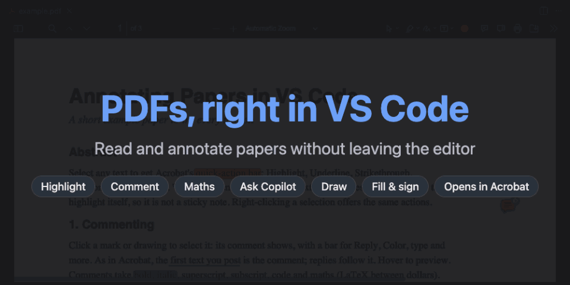
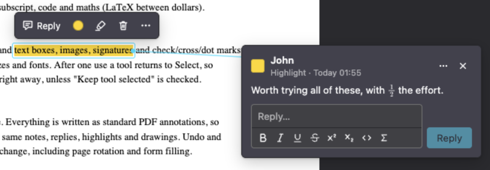
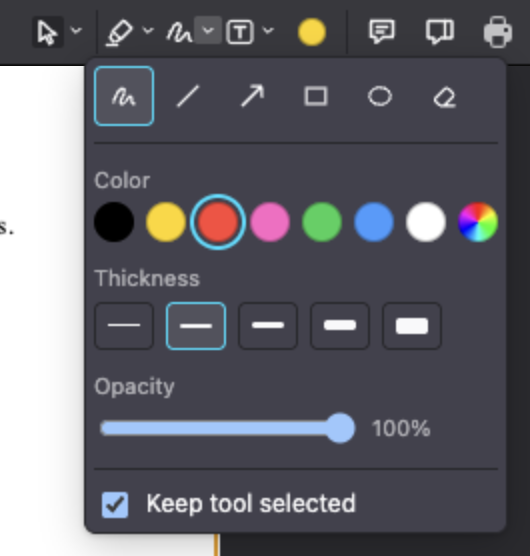

# PDF Viewer & Editor

Read, annotate, fill and sign PDFs (research papers especially) without leaving VS Code. Everything is saved as standard PDF annotations, so the same file opens in Acrobat, Preview and browsers.



> [!TIP]
> Open [`resources/media/example.pdf`](resources/media/example.pdf) for a guided tour.

## Features

| | |
| --- | --- |
| 🖍️ **Annotate** | Highlight, underline, comment, reply and resolve, as in Acrobat |
| ✍️ **Rich text** | Bold, italic, `code` and `$\LaTeX$` in comments and text boxes |
| 🎨 **Draw** | Pen, shapes, arrows, images, and text boxes in six fonts |
| 🖊️ **Fill & sign** | Forms, signatures and ✓ ✗ marks |
| ✨ **Copilot** | Explain or summarize a passage with any Copilot model (Claude, GPT, …); `@pdf` in Copilot Chat |
| 📄 **Pages** | Rotate, reorder, insert, print; undo everything |

| | |
| --- | --- |
|  |  |
| Comments open beside the page, joined to their mark. | Each tool's dropdown holds its colours, sizes and fonts. |

> [!NOTE]
> The PDF's own text and images cannot be edited: in Acrobat that is the paid "Edit PDF", and PDF pages cannot be reflowed.

## Keys

| Key | Action |
| --- | --- |
| `Ctrl/Cmd+S` · `Ctrl/Cmd+P` | Save · print |
| `Ctrl/Cmd+Z` · `Ctrl/Cmd+Shift+Z` | Undo · redo (in a text field: the typing) |
| `Delete` · `Escape` | Delete the selection · close, cancel or deselect |
| `S` · `H` | Select · Hand (pan) |
| `Ctrl/Cmd+B` · `I` · `U` | Bold · italic · underline while writing |
| `Ctrl/Cmd+Enter` | Post a comment or reply |

## Settings

| Setting | Default | Description |
| --- | --- | --- |
| `pdf.authorName` | OS user name | Author of new annotations |
| `pdf.presetColors` | 5 colours | `Name=#RRGGBB` presets shared by every tool |
| `pdf.defaultZoomValue` | `auto` | Zoom when opening a PDF |
| `pdf.sidebarViewOnLoad` | `0` | Side panel when opening a PDF |
| `pdf.printCommand` | default PDF app | Command that prints the file path given to it, e.g. `lpr` |
| `pdf.copilot.model` | a Copilot model | Model for Ask Copilot, as picked with **PDF: Choose Copilot Model…** |

> [!IMPORTANT]
> Ask Copilot and `@pdf` use VS Code's language models: GitHub Copilot's (Claude, GPT, Gemini, …) or one added with your own API key, never a key of ours; VS Code asks once. Ask Copilot sends the passage and its page to the model chosen with **PDF: Choose Copilot Model…**; `@pdf` sends the document's text, your selection and the comments to the model picked in the chat.

## Development

```sh
make setup    # Node.js and dependencies; downloads the newest pdf.js (verified) and the text-box fonts
make test     # unit tests, 100% coverage
make e2e      # the real webview in Chrome, and in VS Code when installed
make example  # regenerate resources/media/example.pdf
make media    # re-record banner.gif and the screenshots in VS Code
```

Press `F5` to try the extension. `npm install` keeps `resources/pdf.js` on the newest pdf.js release (a packaged build ships whichever one was there) and puts the text-box fonts in `resources/fonts`.

<details>
<summary>How it works</summary>

| Concern | Owner |
| --- | --- |
| Pages, text selection, links, forms, find, thumbnails | [pdf.js](https://mozilla.github.io/pdf.js/), the unmodified release (`resources/pdf.js`) |
| Reading and writing annotations | the extension host, with [pdf-lib](https://github.com/Hopding/pdf-lib) (`src/pdf/`) |
| Drawing and editing annotations | the viewer layer (`resources/viewer/`) |
| Undo/redo, dirty state, save, hot exit | VS Code's custom-editor edit stack (`src/editor/`) |
| Ask Copilot, `@pdf` | VS Code's Language Model and Chat APIs (`src/copilot/`) |

The host reads the annotations it manages into a JSON model and gives pdf.js a copy of the file without them, so nothing is drawn twice. One codec per kind (`src/pdf/kinds.ts`) reads its fields and writes its keys and appearance stream, so every reader shows the same thing. Annotations it does not manage are left to pdf.js and only get their comment edited. Saving merges the model back: untouched annotations stay byte-identical, deleted ones go with their replies.

Saved annotation types are all standard: Highlight, Underline, StrikeOut and Squiggly with QuadPoints; Text notes with Popups and `/IRT` replies; review states (Resolved is Acrobat's Completed); FreeText with `/DA`, `/DS` and `/RC` (maths drawn as vector outlines, fonts beyond Helvetica, Times and Courier embedded as subsets); Ink; Square; Circle; Line; image Stamps.

```
src/          extension.ts, protocol.ts (host <-> viewer messages)
  editor/     custom editor: provider, document, webview session, HTML, printing
  pdf/        model, per-kind codecs, reader, writer, rich text, maths, images, pages
  copilot/    prompts, Language Model API, @pdf chat participant
resources/viewer/   the webview: main.mjs (entry), one module per part of the UI, viewer.css
scripts/      pdf.js and font downloads (pdfjs.mjs), example.pdf, README media
test/         unit tests and end-to-end suites (e2e/)
```

</details>

## License

MIT. pdf.js (Apache-2.0) and MathJax (Apache-2.0) are bundled unmodified, as are the Roboto, Lora and Comic Neue fonts (SIL Open Font License; each license is in `resources/fonts`).
